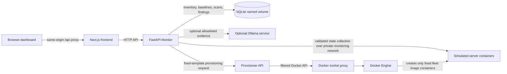

# SentinelOps

SentinelOps is a local configuration security and drift monitoring demo. It collects a small, validated configuration contract from simulated Docker servers, compares each server with its own explicitly approved baseline, applies deterministic policy severity, and stores scan evidence in SQLite. It is intended for local demonstrations and engineering review; it does not collect state from real infrastructure.

## Video Demonstration

[Watch the SentinelOps demonstration](VIDEO_DEMO_URL)

<!-- Replace VIDEO_DEMO_URL with a public YouTube, Loom, or other shareable demonstration URL before publishing the repository. -->

The demonstration should show fleet health, explicit baseline approval, a clean scan, predefined drift, policy severity, scan history, reset and recovery, and optional advisory AI analysis.

## Features

- Three simulated server containers report versioned configuration and environment state over a private Compose network.
- The Monitor validates each response, checks the configured server identity, and computes canonical SHA-256 fingerprints.
- Each server has independent, versioned baseline candidates. A person must explicitly approve a candidate before it becomes trusted.
- Deterministic field-level comparison reports changed, missing, and unexpected fields with expected and observed evidence. Sensitive field paths are redacted.
- YAML policies assign severity to violations; peer similarity is supplementary evidence and does not replace baseline comparison.
- SQLite persists server inventory, baseline versions, scans, per-server results, and AI analysis in a named Docker volume.
- The dashboard reads live API data and supports scan, baseline approval, predefined demo drift/reset, server provisioning from fixed templates, and persisted scan inspection.
- Optional Ollama analysis explains already verified drift. It is advisory; it does not set deterministic severity or modify a server.

## Video demonstration workflow

1. Start the Compose services and dashboard.
2. Wait for the Monitor to collect the simulated fleet.
3. Review and approve each pending server baseline in **Baseline enrollment**.
4. Run a scan and inspect the clean result.
5. Apply a predefined drift scenario and run a scan.
6. Inspect the field-level finding, policy severity, and saved scan.
7. Reset the simulated server and verify recovery in a later scan.
8. Optionally inspect the AI explanation when AI is enabled.

## Architecture



The browser talks to the Next.js dashboard. Its `/api/*` requests use a same-origin rewrite to the Monitor. The Monitor reaches collectors only on the private `monitoring` network. SQLite is mounted at `/data/configguard.db`. Optional Ollama is attached to an AI-only Compose network, separate from the fleet collector network. The Provisioner is isolated from the Monitor's Docker socket access: only the Docker socket proxy mounts the host socket, and it is not published on a host port.

All server containers in the supplied Compose project are simulations using `fleet/app.py` and checked-in example configurations. The API can provision additional containers from three built-in templates; it cannot target arbitrary hosts or accept arbitrary Docker settings.

## Detection and design decisions

### State validation and collection

Each simulated server serves a versioned state document. The Monitor validates the schema with Pydantic models and checks response identity headers against the configured registry. It distinguishes successful collection from failure. A failed or unconfigured server is `unable_to_assess`; it is never counted as clean.

### Fingerprints and drift

The fingerprint code serializes the validated `config` and `environment` in canonical JSON form and hashes the result with SHA-256. Volatile collection time and identity metadata are not part of the fingerprint. Field-level comparison uses the approved server baseline and reports changed values, missing fields, or unexpected fields. The fingerprint is a reproducible state identifier; it is not a Merkle tree or a cryptographic proof of host integrity.

### Policy severity and peer evidence

`config/policies.yaml` defines supported rules and default severities by difference type. Rules evaluate observed values, such as debug mode, TLS minimum, connection range, and approved runtime version. Policy violations are attached to deterministic findings. Peer comparison groups compatible validated states and reports similarity or an outlier when enough peers exist; it is supplementary and does not replace the approved baseline.

### Baseline approval

Newly discovered servers receive a pending candidate from their collected state. Candidates are not trusted automatically. Approval records an actor name and reason for audit display, then creates an explicit approved baseline version. This demo does not authenticate or authorize that actor. Historical baseline versions remain available for scan provenance.

### Persistence and failure semantics

The Monitor stores server registrations, baseline candidates/versions, scans, per-server collection and assessment results, and AI analysis in SQLite. Compose mounts a named `configguard_data` volume so data survives container replacement and `docker compose down`. `docker compose down -v` removes it. A partial scan records failures and successful assessments separately; failure does not mean the server is clean.

### Advisory AI

When enabled, the backend builds evidence from actual deterministic findings and sends only allowlisted, non-redacted fields to the configured OpenAI-compatible endpoint. It does not send a full server snapshot. The response is stored against the scan and presented separately from deterministic assessment. AI is optional, may be unavailable, and never changes severity or applies remediation. `AI_DEMO_FALLBACK=true` uses a clearly identified local demonstration template if the provider fails; that text is not model output.

## Technology stack

- Python 3.11–3.12, FastAPI, Pydantic 2, HTTPX, PyYAML, and SQLite.
- Next.js 16, React 19, TypeScript, and Lucide icons.
- Docker Engine and Docker Compose v2 for the local simulated fleet and isolated provisioning demo.
- Optional Ollama using its OpenAI-compatible API.

Dependency version ranges are defined in `pyproject.toml`; exact frontend dependency resolutions are recorded in `frontend/package-lock.json`.

## Repository layout

```text
SentinelOps/
├── backend/app/
│   ├── collector/       Fleet registry and validated HTTP collection
│   ├── config/          Baseline, policy, and template loading
│   ├── core/            Fingerprinting, drift detection, scheduler, AI client
│   ├── schemas/         API and state contracts
│   ├── storage/         SQLite schema and persistence operations
│   ├── main.py          Monitor API, scans, baselines, demo controls
│   └── provisioner.py   Fixed-template container provisioning API
├── config/              Server registry, state schema, policies, templates
├── fleet/               Simulated server API and sample server states
├── frontend/            Next.js dashboard and same-origin Monitor API proxy
├── tests/               Unit, API, contract, persistence, and Docker integration tests
├── docker-compose.yml   Monitor, simulated servers, Provisioner, networks, volumes
├── pyproject.toml        Python dependencies and tooling configuration
└── README.md             Setup, architecture, security boundaries, and demo guide
```

## Prerequisites

- Docker Engine and Docker Compose v2.
- Node.js 20.9 or newer and npm compatible with the checked-in lockfile.
- Python 3.11 or 3.12 for local backend development and tests.
- Optional: enough local disk and memory for Ollama and the selected model.

## Configuration

Start from `.env.example`. It contains safe local defaults and no API key. `.env` is ignored by Git and should hold machine-specific values. The Monitor reads the following settings:

| Variable | Purpose |
| --- | --- |
| `APP_ENV` | Runtime environment label. |
| `API_HOST`, `API_PORT` | Host interface and port for the published Monitor API; default binding is loopback. |
| `DEMO_MODE` | Enables the predefined drift and reset routes in the Monitor and simulated servers. |
| `SCAN_INTERVAL_SECONDS` | Periodic scan interval. |
| `MONITOR_SCHEDULER_ENABLED` | Enables scheduled background collection. |
| `DATABASE_URL` | SQLite URL; Compose stores the database in `/data` on a named volume. |
| `AI_ENABLED` | Enables optional advisory analysis. Disabled in the example by default. |
| `AI_BASE_URL` | Backend-only OpenAI-compatible endpoint. Compose uses the private Ollama service when the optional profile is enabled. |
| `AI_API_KEY` | Optional backend-only provider credential; blank for local Ollama. Never expose it through a `NEXT_PUBLIC_` variable. |
| `AI_MODEL` | Model name sent to the configured provider. |
| `AI_TIMEOUT_SECONDS` | External AI request timeout. |
| `AI_DEMO_FALLBACK` | Enables the clearly labeled local demo explanation after provider failure. |

`CONFIGGUARD_API_TARGET` is an optional frontend server-side rewrite target, not a browser API key. The Compose `.env.example` sets the Monitor to loopback by default. Change that binding only when you intend to expose the API and have added appropriate access controls.

## Quick start

From the repository root:

```bash
cp -n .env.example .env
sudo docker compose up --build -d --wait
sudo docker compose ps
```

`sudo` may be omitted when the current user already has permission to use Docker. The Monitor API is available at <http://127.0.0.1:8000>; readiness is `GET /api/ready`, and process health is `GET /api/health`. The server containers do not publish host ports.

In another terminal:

```bash
cd frontend
npm ci
npm run dev
```

Open <http://localhost:3000>. Next.js proxies `/api/*` to `http://127.0.0.1:8000` by default. Set `CONFIGGUARD_API_TARGET` in the frontend environment when the Monitor uses a different URL.

On first startup, the Monitor collects each configured server and creates pending baseline candidates. Review the expected and observed state and explicitly approve each baseline before treating the server as clean. The dashboard shows Monitor readiness and collection failures separately.

### Optional local AI analysis

AI is disabled by default. To use local Ollama, set `AI_ENABLED=true` and `AI_BASE_URL=http://ollama:11434/v1` in `.env`, then start the optional service and download the configured model:

```bash
sudo docker compose --profile ai up --build -d --wait
sudo docker compose exec ollama ollama pull qwen2.5:1.5b
```

After the model is ready, run a drift scan. If a scan was analyzed before the model finished downloading, use **Try Ollama again** in the dashboard. To disable AI, set `AI_ENABLED=false` and recreate the Monitor. Do not use a temporary tunnel URL as a long-lived provider endpoint.

## Demonstration workflow

1. Start the Monitor and fleet using the Quick start commands.
2. Start the dashboard and open <http://localhost:3000>.
3. Wait for registered servers and pending baseline candidates to appear.
4. Enter an audit actor label and approve each intended baseline. The label is metadata, not authentication.
5. Run a scan and inspect each server's result.
6. In **Drift controls**, choose a predefined scenario and apply it to a simulated server.
7. Run or review the resulting scan; inspect field-level expected/observed values and policy severity.
8. Reset the simulated server and verify recovery in a later scan.
9. Inspect saved scans in **Scan history**. Optionally enable AI and review its separate advisory explanation.

**Add server** provisions a container from a built-in role template. It uses Docker Engine through the restricted socket proxy. A newly provisioned server still requires explicit baseline approval. **Decommission** preserves the server record and its scan history.

To stop while retaining data, run `docker compose down`. Do not use `docker compose down -v` if you want to keep the SQLite history, server identities, and downloaded Ollama models.

## API reference

The Monitor API uses the `/api` prefix.

| Method | Route | Purpose |
| --- | --- | --- |
| `GET` | `/api/health` | Process health. |
| `GET` | `/api/ready` | Database readiness, fleet count, and demo-control state. |
| `GET` | `/api/fleet/states` | Collect current state from registered servers. |
| `GET` | `/api/servers` | Paginated server inventory. |
| `GET` | `/api/servers/{server_id}` | Server details and current baseline information. |
| `GET` | `/api/servers/{server_id}/baseline-candidates` | Pending baseline candidates. |
| `POST` | `/api/servers/{server_id}/baselines/{baseline_id}/approve` | Explicitly approve a candidate. |
| `GET` | `/api/servers/{server_id}/baselines` | Baseline version history. |
| `POST` | `/api/scans` | Collect, assess, and persist an on-demand scan. |
| `GET` | `/api/scans` | Paginated scan history. |
| `GET` | `/api/scans/{scan_id}` | Persisted scan detail. |
| `GET`, `POST` | `/api/scans/{scan_id}/analysis` | Retrieve or request advisory AI analysis. |
| `GET` | `/api/server-templates` | Built-in provisioning templates. |
| `POST` | `/api/servers/provision` | Provision a simulated server from an allowed template. |
| `POST` | `/api/servers/{server_id}/decommission` | Decommission while retaining history. |
| `POST` | `/api/fleet/{server_id}/simulate-drift` | Apply an allowlisted demo change when demo mode is enabled. |
| `POST` | `/api/fleet/{server_id}/reset` | Restore and verify a simulated server's original state. |

FastAPI's interactive API documentation is available at `/docs` while the Monitor is running.

## Tests and quality checks

From the repository root:

```bash
.venv/bin/python -m pytest -q
.venv/bin/ruff check .
.venv/bin/ruff format --check backend fleet tests
sudo docker compose config --quiet
```

The Docker integration smoke test is marked `integration`. It runs when Docker Engine and Compose v2 are reachable; otherwise pytest reports the reason it was skipped. Run only non-Docker tests with `.venv/bin/python -m pytest -q -m 'not integration'`.

For frontend quality checks:

```bash
cd frontend
npm ci
npm run lint
npm run build
```

A successful unit test run alone does not verify the live Docker demonstration.

## Security considerations and limitations

- The fleet consists of simulated containers. Real host collection and production deployment are not implemented.
- This MVP has no user authentication or authorization. Baseline actor labels, provisioning, decommission, and demo controls are not access controls. Keep the Monitor bound to loopback and do not expose it to an untrusted network.
- Server collectors are reachable only inside the private Compose monitoring network, but they do not authenticate individual callers on that network.
- The Provisioner uses a Docker socket proxy with container, volume, create, and delete operations enabled. The socket proxy and Provisioner are privileged parts of the local demo boundary; do not attach untrusted services to their networks.
- SQLite is suitable for this single-instance local demo; concurrent multi-user production use is not a goal of this project.
- A collection or policy assessment failure is not a clean result. The UI preserves unavailable and partial states.
- Optional AI receives allowlisted, non-redacted finding evidence. Provider availability and output quality vary. AI text is advisory and is not an authoritative assessment or remediation action.
- Dynamic provisioning accepts only built-in templates and does not implement real authentication, arbitrary container configuration, or server removal that erases history.

## Future work

Meaningful next steps include adding authenticated operator roles and audit identity, testing a deployment boundary beyond local Docker, and adding real-host collectors only with a reviewed trust and credential model.

## License

No license file is present. No license has been added; choose a license before accepting external contributions or redistributing the project.
